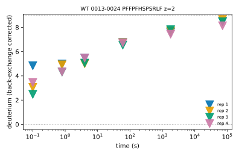
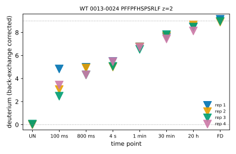

# Controls and times

Every series (a peptide at one charge) has two kinds of spectra: **time points**, measured
after a labelling time, and **controls**: the undeuterated spectrum and the fully deuterated
one, which set the scale of the back-exchange correction. *hxex* tells them apart by a **role**,
never by a number.

## Where the role comes from

- **HDExaminer SpecExport and HX-Express files.** The labels already say it: `Non` (SpecExport)
  and `undeut` (HX-Express) files are undeuterated controls, `Full` and `TD` files are fully
  deuterated controls. Nothing to set.
- **mzML and Thermo raw files.** Each control file gets a `role` in its `[[input.runs]]` table
  and no `time` (example below).

```toml
[[input.runs]]
path = "UN_01.raw"
sample = "WT"
role = "undeut"

[[input.runs]]
path = "TD_01.raw"
sample = "WT"
role = "fulldeut"

[[input.runs]]
path = "D_5min_01.raw"
sample = "WT"
time = "5 min"
```

A file with neither `time` nor `role` is a kinetics run, where every scan has its own time.

A control carries no time: its `time` is blank in every table and the figures show it as `UN`
or `FD`, first and last on an index axis, as a line on a time axis. That is why a
back-exchange experiment, where a real time point can be at 0 s next to the undeuterated
control, needs no trick to keep the two apart.





*The same series of the published B5 data drawn against time (`x = "time"`, log scale; the
controls set the dotted limits) and by index (`x = "index"`; the controls are the first and
last points).*

## Seeing the roles

`hxex check` counts the control files of every sample before anything is read (for HX-Express
sheets, whose labels are inside, it says so instead), and names each scan-format run's role:

```
entries        9 in SpecExport
  D109H: 3 entries, 9 undeuterated and 5 fully deuterated control files
  R120G: 3 entries, 6 undeuterated and 5 fully deuterated control files
  WT: 3 entries, 9 undeuterated and 9 fully deuterated control files
```

```
run UN_01.raw: sample WT, rep 1, undeuterated control, 412 scans; 12 of 12 targets have scans
run D_5min_01.raw: sample WT, rep 1, time 5 min, 398 scans; 12 of 12 targets have scans
```

Its `controls` line repeats any `undeut_at`, `fulldeut_at` and `*_marked = false` setting in
words. After the run, `hxex info` counts the control spectra of the bundle (and the times they
also have, when they are time points too) and says whether the times are real:

```
controls       yes
roles          24 undeuterated (9 series); 19 fully deuterated (9 series)
times          seconds
```

## A time point that is also a control

Some data have no separate fully deuterated file, but a late time point that has reached its
plateau. `fulldeut_at` in `[run.controls]` makes the spectra at that time serve as the fully
deuterated control as well; they keep their time, so they stay a point of the time course:

```toml
[run.controls]
fulldeut_at = "20 h"
```

`undeut_at` does the same for the undeuterated control, for example the equilibrium end point of
a back-exchange run. When the data also have a marked fully deuterated file that you do not
trust (one that reads low, say), add `fulldeut_marked = false`: the marked file then does not
serve as the control, only the spectra at `fulldeut_at` do, and its spectra stay fitted. The
same settings exist in `[analysis.controls]` for an analysis of an existing bundle. The time must be one at which spectra were measured; otherwise *hxex* lists the
times it has. For a scan-format file, giving the run both `time` and `role` in `[[input.runs]]`
does the same thing.

## Writing times

Every time in the project file is a number of seconds or text with a unit: `60`, `"60 s"`,
`"5 min"`, `"20 h"`, `"250 ms"`, `"1h21m"`. The units are `s`, `sec`, `m`, `min`, `h`, `hr`,
`ms` and their long forms, in any case. *hxex* converts them when it reads the file, so the tables
always hold seconds; figures label times in a readable unit (`20 h`, not `72000 s`). In an
HX-Express sheet the labels keep that format's own convention, where `1.2 min` means the second
spectrum at 1 min; in the project file `"1.5 min"` is 90 s.

## Times that only order the points

Some data carry no labelling times, only labels that order the points (1, 2, 3, or the
HX-Express test sets' dummy times). `[input] time_scale = "order"` says so:

```toml
[input]
time_scale = "order"
```

The numbers are still read and stored as given, but *hxex* never treats them as seconds: the
uptake is drawn by index whatever `[figures] x` says (with a warning when it says
`"time"`), figures and file names label the points by their number (`point 2`,
`profile_WT_2.png`), and the analyses that need real times, the fragment ladder kinetics and
the protection factors, refuse with a message that names the setting. The scale is recorded
with the spectra, so a rerun from a stored bundle keeps it unless the project file sets it
again, and `hxex check` and `hxex info` show it on their `times` line.

