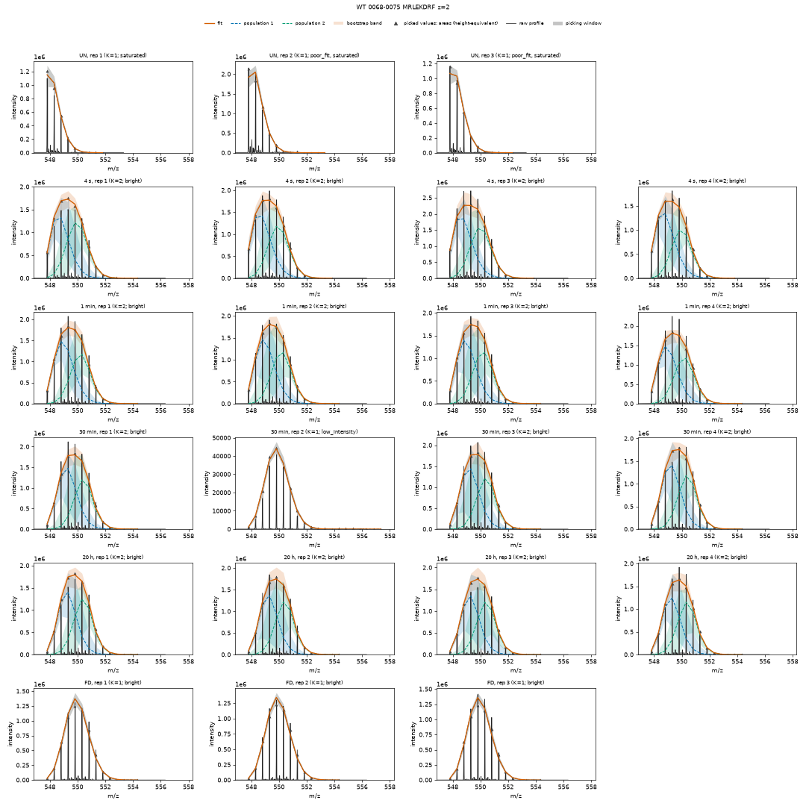
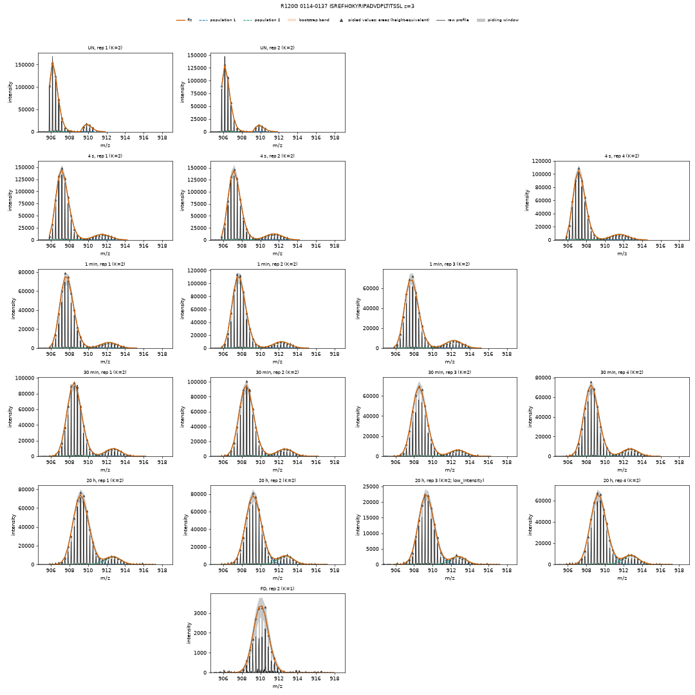
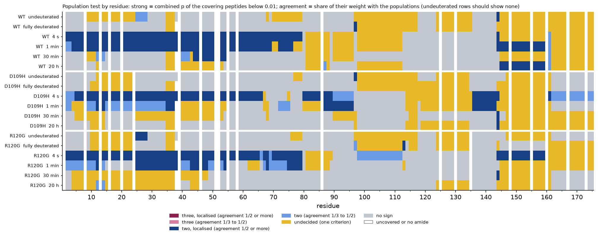
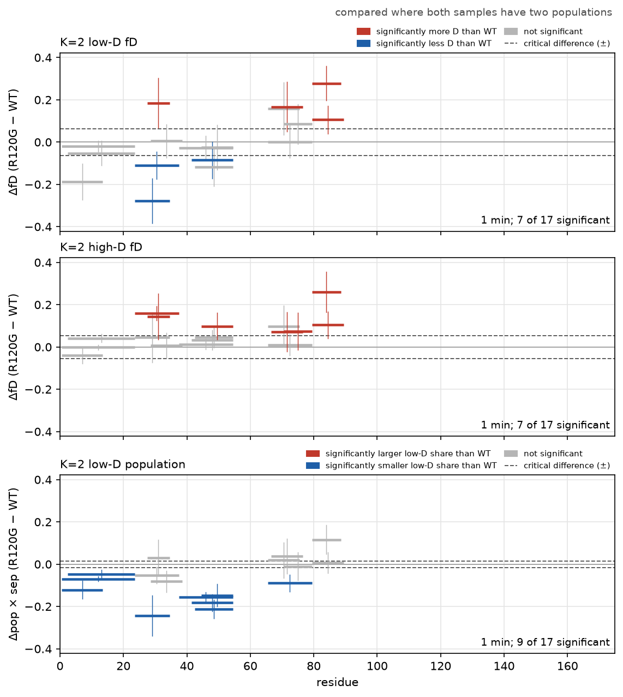
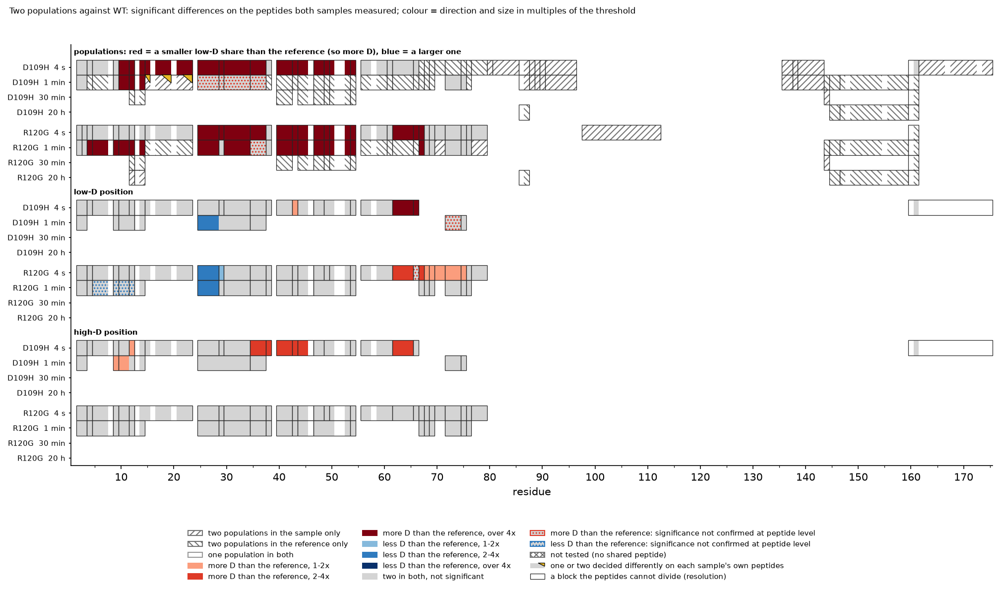

# Tutorial, part 2: reading the fits

[Part 1](tutorial.md) took the data from the exported spectra to a comparison of the samples,
with one population per peptide. This part looks more closely at the fits: spectra that need a
second look, decisions you record in a review table, how many populations each peptide has, and
the comparison of two populations between samples. It takes about an hour and a half, of which
up to an hour is the computer working (a quarter of an hour with a GPU).

It continues in the folder of part 1, `hxex_b5_tutorial`, with its results: do part 1 first.
The steps are also in the notebook `hxex_b5_tutorial_2_fits.ipynb`
([The notebooks](tutorial.md#the-notebooks)).

## Step 1: three more peptides

This part runs `hxex report` and `hxex analyse` several times. So that each one replaces what
it wrote before without being told, switch on `overwrite` in the `[output]` part of
`hxex.toml`:

```bash
hxex set hxex.toml output.overwrite true
```

(Without it, each command stops at the folder it wrote before and asks for `--overwrite`. The
rule is there to protect results you meant to keep: for your own projects, decide which you
prefer.)

Then three peptides to look at, in the `[figures]` part: WT 68-75 (`data_id` 107), WT 42-54
(56, from part 1), and R120G 114-137 at charge 3 (166):

```bash
hxex set hxex.toml figures.series "[107, 56, 166]"
```

and draw them:

```bash
hxex report hxex.toml --figures
```

## Step 2: a very bright peptide

Open `WT_0068_0075_MRLEKDRF_z_2.pdf`. The title of each spectrum says its number of
populations and its flags:



- The three undeuterated controls (UN) are flagged `saturated`: the peaks beside the tallest
  read higher than the peptide's natural isotope pattern allows, which is how a detector
  behaves when it receives more ions than it can count.
- Every labelled spectrum but one is flagged `bright`: at least as bright as those controls,
  so likely distorted in the same way. Their tops are 1.7 to 2.3 million, and their envelopes
  look flattened: too low in the middle, too high at both sides. A flattened envelope is what
  two populations side by side look like, and the fit duly describes them with two
  (`K=2`), about half and half, at every time point.
- The one dim spectrum, 30 min replicate 2 (top 44,000, flagged `low_intensity`), has an
  ordinary envelope, and one population.

How bright is too bright? *hxex* measures it for the whole run:

```bash
hxex info hxex.toml
```

The `noise` line ends with `controls with tops of 400,000 or more left out`: above that,
the undeuterated controls of this run no longer follow the noise of the others, so they are
left out of the noise measurement. The bright spectra of 68-75 are four to five times above it.

**What the analysis made of it.** Open `results_analysis_WT/species_uptake.csv`, the
analysis' table of every peptide at every time, and find WT, `start` 68, `end` 75. At 1 min,
30 min, and 20 h, `best_set_K` (the number of populations best supported by all the spectra of
that time together) is 1: one of the two populations of each bright fit lies above full
deuteration, which cannot be, so the analysis does not use those two-population fits
(`left_out_summary.csv` counts such fits on the line `a population above fD 1.1`, 552 in this
run). At 4 s it is 2, and from these spectra alone it cannot be told whether that is a real
early mixture or the same flattening.

And the dim spectrum? `left_out_spectra.csv` lists it, as a `replicate outlier`: it reads more
deuterium (fD 0.95) than its three bright replicates, so the analysis left it out. Yet it is the
one spectrum of that time within the detector's range.

## Step 3: record a decision in the review table

Decisions like this one go in a *review table*: your own copy of `spectra.csv` in which you fill
in three columns, `review_status` (`accepted` or `rejected`), `review_K` (a number of
populations you choose), and `note`. Nothing is refitted; the decisions are applied whenever the
results are reported or analysed.

Copy `results_tables/spectra.csv` into the project folder, next to `hxex.toml`, and rename
the copy `user_review_table.csv`. Open it, and in the row of `WT`, `0068-0075`, time `1800`
(30 min), replicate (`rep`) 2, type `accepted` in the `review_status` column and `dim, below
the saturation onset` in `note`. Save it, keeping the CSV format. A spectrum you accepted is
never left out by the analysis' filters.

Then tell *hxex* about the table:

```bash
hxex set hxex.toml review.table user_review_table.csv
```

This switches on the `[review]` part with the table's name. (In the text editor: find the
switched-off `# [review]` part, and delete the `# ` in front of its first two lines,
`[review]` and `table = "user_review_table.csv"`.)

Whether the dim spectrum or the bright ones are nearer the truth is your judgement as the
scientist; the tutorial accepts it to show how. The other decisions you could make here:
`rejected` leaves a spectrum out of everything after the fit, and `review_K` sets its number of
populations (for example to 1, for a second population you know is wrong).

## Step 4: what to leave alone

In `WT_0042_0054_TSLSPFYLRPPSF_z_2.pdf`, the 30 min spectra have a second population too, a
small one: 6 to 10 % in each replicate. One spectrum alone cannot pin down so small a share (the
bootstrap gives each share an error of 4 to 13 points, about as large as the share), but
together they can: all four replicates find it, it continues the shrinking of the slow
population from 4 s and 1 min, and no such population is found at 20 h or in the controls. In
`species_uptake.csv`, WT 42-54 at 30 min has `best_set_K` 2, with a share of 8.5 ± 4 % from
all four replicates together. Setting these spectra to one population (`review_K`) would throw
that away: keep `review_K` for a second population you know is wrong.

## Step 5: suspect spectra

Some spectra hold more than the peptide. A sign is in `series.csv`: its `control_notes` column
says `m0_multimodal` when the undeuterated controls of a series are best described by more than
one population, and `fd_multimodal` for the fully deuterated ones. An undeuterated control
should be one envelope, the peptide's natural isotope pattern, so a second one there is
something else.

Five series of this run have `m0_multimodal`. Open `R120G_0114_0137_ISREFHGKYRIPADVDPLTITSSL_z_3.pdf`:



Beside the peptide's envelope there is a second, smaller one, about 11 Da heavier, in every
spectrum, the undeuterated controls included, and it moves with the peptide as deuterium is
taken up. It is another species (an adduct, or another ion of almost the same m/z), not a state
of the protein. Its fits are no help either way: the second envelope is beyond the peptide's
full deuteration, so the analysis does not use the two-population fits, and the one-population
fits average the two species. The series is better left out.

The `fd_multimodal` notes of this run mostly have another cause: they are on bright peptides,
such as WT 29-38 and 68-75, whose fully deuterated controls are flattened like the labelled
spectra of step 2.

To leave a whole series out, write a rule. A rule has several lines, so it goes in with the
text editor (close the editor again afterwards, before the next `hxex set`). Below the two
`[review]` lines of step 3, add:

```toml
[[review.exclude]]
sample = "R120G"
peptide_range = "114-137"
charge = 3
note = "a second species in every spectrum, the undeuterated controls too"
```

A spectrum that matches the rule is treated as rejected, as in the review table; its fits are
kept ([Excluding spectra](excluding-spectra.md)). Now check that *hxex* reads both decisions,
and write the tables, the figures, and the analysis again:

```bash
hxex check hxex.toml
hxex report hxex.toml --figures
hxex analyse hxex.toml
```

`check` has the lines `review table ... 1 spectra: 0 rejected, 1 accepted, 0 with a chosen K`
and `[[review.exclude]] #1 (sample R120G, peptide range 114-137, charge 3 ...): 17 of 5261
spectra`. In the new `species_uptake.csv`, WT 68-75 at 30 min is the mean of four spectra, not
three: 6.35 ± 0.10 D instead of 6.25 ± 0.06 D.

## Step 6: how many populations: the population test

So far the number of populations of each spectrum was chosen by a criterion that weighs the
better fit of more populations against their number, and the analysis combined the spectra of a
peptide and time with the same kind of criterion (`best_set_K`). The *population test* asks the
question more strictly: is a further population needed, judged against simulated spectra that
have the same noise but no such population? It tests every spectrum, and the spectra of each
peptide and time together ([The population test](population-test.md)).

The test is switched off in the template; setting its number of simulated spectra (20, also
its default) switches it on:

```bash
hxex set hxex.toml run.population_test.simulations 20
```

(In the text editor: delete the `# ` in front of the `# [run.population_test]` heading.)

Then add the test to the results you have, and analyse again:

```bash
hxex resume hxex.toml
hxex analyse hxex.toml
```

`hxex resume` keeps the fits and adds the test: about 40 minutes on eight cores of a workstation,
up to an hour or more on a laptop, and 15 minutes with a GPU. Each spectrum's number of populations is now the test's (`selected K: 1: 3218, 2: 654,
3: 2`, against 2983, 875, and 16 before), and the analysis uses the test: `species_uptake.csv`
gains `set_test_K`, the test's verdict for each peptide and time, and `best_set_reason` says how
it was reached (`set test: two (p = ..., added population ...)`).

Most decisions stay as they were. One that changes is WT 42-54 at 30 min of step 4: the
test finds the evidence for the small population strong (p = 2.6 × 10⁻¹⁴), but its share,
0.09, is below the 0.10 the test asks of a population (`min_population`), so the test reads
one population there. Both readings are defensible; the test is the stricter one, and the one
to report if you use it.

The test also looks at the undeuterated controls of every peptide: `hxex resume` says that 6
peptides have two populations or more in an undeuterated set, and `species_uptake.csv` marks
them `undeuterated_two`. Here they are long peptides (residues 1-23, 24-37, 61-75, 80-96, and
138-175 in every sample, and 90-112 in D109H). It is a flag, not a decision: whether an
undeuterated set holds another species, as in step 5, or only an envelope a little broader than
one population, its spectra show; look at them before trusting that peptide's two populations.

**The population tiers** (`population_tiers.png`) carry the test down to the residues: for each
residue, sample, and time, whether the peptides covering it show two populations, strongly and
in agreement (`two, localised`, dark blue), with less agreement (`two`, light blue), on one
criterion only (`undecided`, yellow), or not at all (grey). The undeuterated and fully
deuterated rows should show none; the yellow there marks the bright peptides of step 2.



## Step 7: comparing the two populations

Where a peptide has two populations in both samples, the two can be compared: where each
population lies, and how much of each there is. The Woods plot of part 1 has a second figure
for this, `woods_K2_R120G_1min.png`: the difference in the share of the high-D population (top),
multiplied by the distance between the two populations, so that it is in deuterium per amide
like the panels below and judged against the same kind of dashed line, then in the position of
the low-D population (middle) and of the high-D population (bottom)
([Reading the Woods plot](outputs.md#figures-from-hxex-analyse)). On every panel red means more
deuterium than WT and blue less. Here R120G has more of the high-D population than WT over most
of the first 80 residues (red in the top panel), and some of the positions differ too: much the same two states, populated
differently.



`residue_significance_K2_R120G.png` shows the same residue by residue, for every time, in
three sections in the same order: the shares, the low-D positions, and the high-D positions
(one such figure per sample). Its colours follow
the same rule: in the shares section, red means a smaller low-D share than WT, so more
deuterium, as in the residue map of part 1. Hatching marks residues where only one of the two samples has two
populations.



A comparison of two populations needs the bootstrap at K = 2 (the `ks = [1, 2]` of part 1):
without it, these figures say which residues have two populations but test no differences.

## Step 8: a note on the noise

Every number above rests on how noisy each peak is taken to be. *hxex* measures it from the
undeuterated controls of the run: the `noise` line of `hxex info` gives the variance of a peak of
intensity I as `z x b1 x I + (9 % of I)^2`, a counting part that grows with the charge z and a
part proportional to the peak ([The noise model](noise-model.md)). Spectra brighter than the
controls the noise was measured on, such as those of step 2, are where this is least certain.

## What you did

| Step | Command | What it did |
|---|---|---|
| 1 | `hxex set hxex.toml ...` | changed settings of the project file (also in steps 3 and 6) |
| 1 | `hxex report hxex.toml --figures` | drew three more peptides |
| 2 | `hxex info hxex.toml` | showed the run's noise and the brightness limit |
| 5 | `hxex check hxex.toml` | read the review table and the rule |
| 5 | `hxex report hxex.toml --figures`, `hxex analyse hxex.toml` | applied your decisions |
| 6 | `hxex resume hxex.toml` | added the population test, the fits kept |
| 6 | `hxex analyse hxex.toml` | analysed with the test |

For your own data, start from [Your first project](first-project.md); the
[review table](project-file.md#the-user-review-table), [Excluding spectra](excluding-spectra.md),
and [The population test](population-test.md) have the details of this part.
