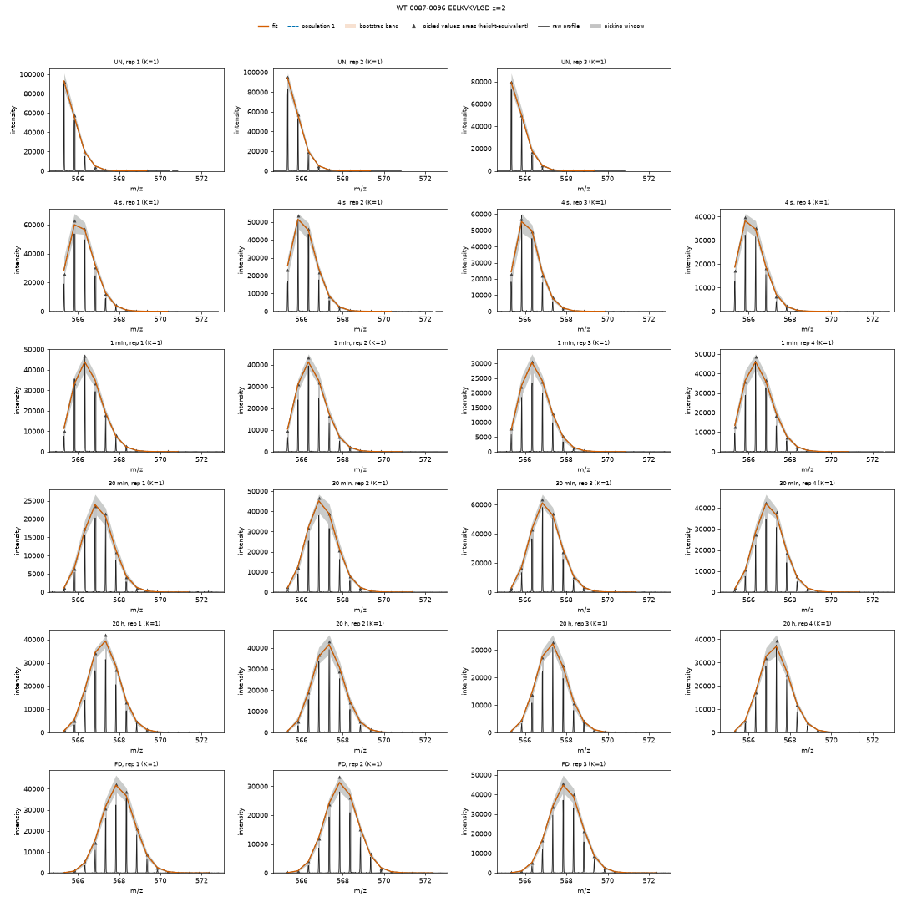
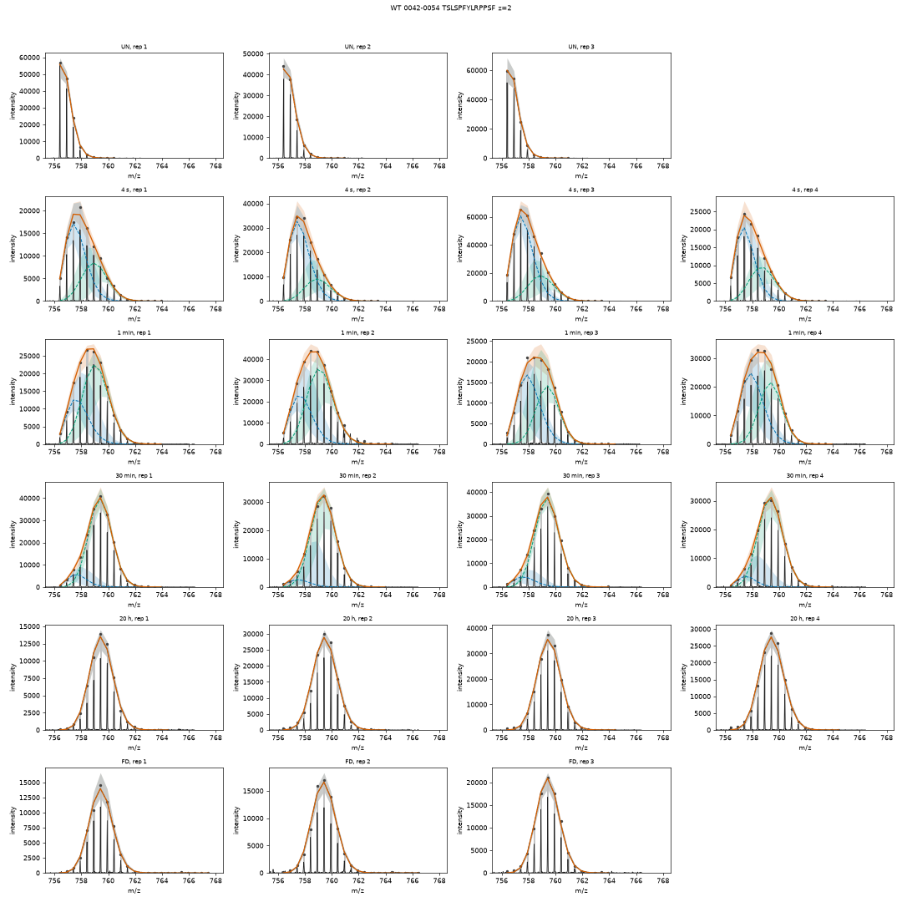
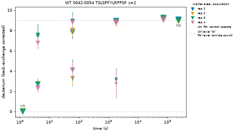
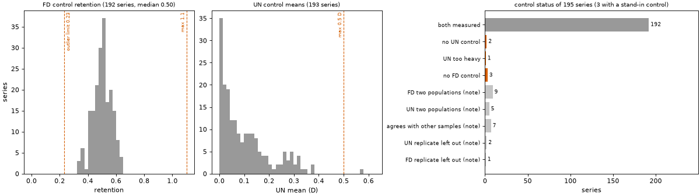
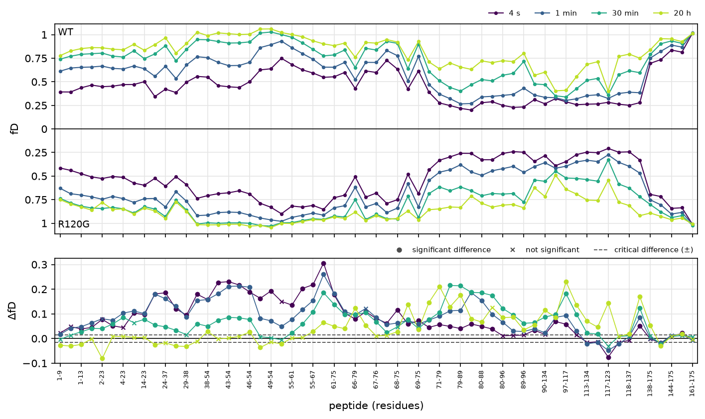
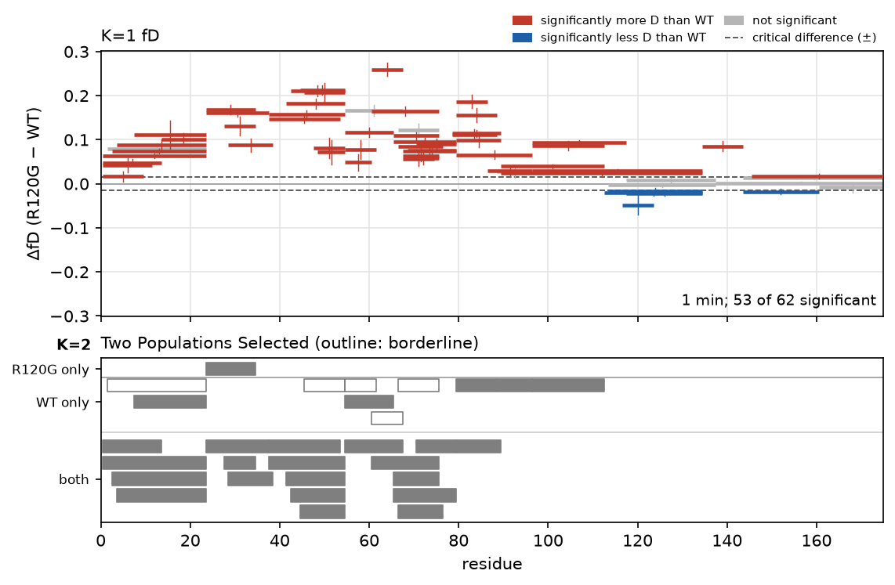
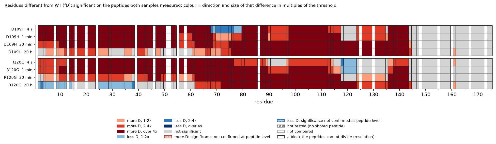

# Tutorial, part 1: a protein and two disease variants

This tutorial takes you through a complete *hxex* analysis of real, published data, from the
exported spectra to a comparison of three samples. You type every command yourself, so by the
end you will have used each part of *hxex* once and seen what it writes. It takes about an
hour, of which about half is the computer working.

[Part 2](tutorial-fits.md) continues in the same folder. It looks closely at the fits:
reviewing spectra, how many populations a peptide has, and comparing two populations between
samples.

The same steps are in a Jupyter notebook, which comes with the data (see
[The notebooks](#the-notebooks) at the end). This page needs no Jupyter.

## The data

The spectra are from a study of HSPB5 (αB-crystallin), a small heat shock protein, and two
variants of it linked to disease, D109H and R120G:

> Woods CN, Janowska MK, Ulmer LD, Kaur Sidhu J, Stone NL, James EI, Guttman M, Bush MF,
> Klevit RE. Activation mechanism of small heat shock protein HSPB5 revealed by
> disease-associated mutants. *Proc Natl Acad Sci USA* 122(20), e2425061122 (2025).
> <https://doi.org/10.1073/pnas.2425061122>

Please cite this paper if you use the data. Each protein (0.04 mg/mL) was labelled at room
temperature in 85 % D₂O buffer, pH 7.5, for 4 s, 1 min, 30 min, and 20 h, with three or four
replicates of each, and measured on a Waters Synapt G2-Si. Undeuterated and fully deuterated
controls were measured as well. The spectra were exported from HDExaminer as a SpecExport
folder, which is what *hxex* reads. The folders also hold two very short labelling times,
0.1 s and 0.8 s, measured with a quench-flow setup and not part of the paper: step 4 leaves
them out.

In total there are 5,261 spectra: 63 peptides in each of the three samples, at one or more
charge states.

## Before you start

*hxex* must be installed: see [Installing *hxex*](install.md). To check, open a terminal and
type `hxex --version`.

## Step 1: download the data

Download **`hxex_b5_tutorial.zip`** (39 MB) from
<https://github.com/tuttlelm/hxex/releases/download/tutorial-data-1/hxex_b5_tutorial.zip>
and unzip it where you keep your work, for example in `Documents`:

- **Windows:** right-click the file, choose **Extract All**, then **Extract**.
- **macOS:** double-click the file.
- **Linux:** right-click the file and choose **Extract Here**.

You now have a folder `hxex_b5_tutorial` with:

```
hxex_b5_tutorial/
├── SpecExport/                the spectra, as HDExaminer exported them
│   ├── WT/                    one folder per sample,
│   │   ├── 0001-0009-MDIAIHHPW/      one folder per peptide,
│   │   │   ├── Non-D-1-z2.csv        one file per time point, replicate, and charge
│   │   │   ├── 0.1s-1-z2.csv
│   │   │   ├── 4s-1-z2.csv
│   │   │   ├── ...
│   │   │   └── Full-D-1-z2.csv
│   │   └── ...
│   ├── D109H/
│   ├── R120G/
│   ├── WT.fasta               the protein sequence of each sample
│   ├── D109H.fasta
│   └── R120G.fasta
├── hxex_b5_tutorial_1_basics.ipynb     the notebook of this page
├── hxex_b5_tutorial_2_fits.ipynb       the notebook of part 2
├── tutorial_helpers.py        used by the notebooks
├── README.txt
└── LICENSE.txt
```

The file names say what each spectrum is: `4s-1-z2.csv` is the 4 s time point, replicate 1,
charge 2. `Non-D` files are the undeuterated controls and `Full-D` files the fully deuterated
ones. You do not need to open any of them.

## Step 2: open a terminal in the folder

Commands act on the folder the terminal is "in". Open a terminal in `hxex_b5_tutorial`:

- **Windows**: open the folder in File Explorer, click the address bar at the top, type
  `powershell` and press Enter.
- **macOS**: in Terminal, type `cd ` (with a space after it), drag the folder from Finder onto
  the Terminal window, and press Enter.
- **Linux**: right-click inside the folder and choose **Open in Terminal**.

Every command below is typed there.

## Step 3: write the project file

```bash
hxex init --format specexport
```

This writes `hxex.toml`, the project file: a plain text file with every setting at its usual
value, each with a comment saying what it does. Open it in a plain text editor (Notepad,
TextEdit, or another; see
[Your first project, step 4](first-project.md#step-4-edit-the-project-file)) to read it. Lines
starting with `#` are comments, or settings that are switched off. The settings you are likely
to change come first; everything below the line `Advanced settings` you can leave alone.

You change a setting with `hxex set`, which finds its line, switches it on, and gives it the
new value, or in the text editor. This tutorial uses `hxex set`, and says what the same change
is in the editor.

The data folder is already right: the template says `data_dir = "SpecExport"`, which is the
folder next to `hxex.toml`.

## Step 4: tell *hxex* about the experiment

Make three changes.

**Leave out the quench-flow time points.** These are rules of several lines, which `hxex set`
does not write, so this change is made in the text editor. In the `[input]` part of
`hxex.toml` there is a switched-off example of an `[[input.exclude]]` rule. Below it (still
above `[output]`), add two rules, one for each time:

```toml
[[input.exclude]]
time = "0.1 s"
note = "quench-flow time point (not in the paper)"

[[input.exclude]]
time = "0.8 s"
note = "quench-flow time point (not in the paper)"
```

A spectrum that matches a rule is not fitted, but it is kept with the results, so nothing is
lost. [Excluding spectra](excluding-spectra.md) explains the rules.

Save the file and close the editor. (An editor that still has the file open writes its own
copy back when you save again, over the changes `hxex set` makes. Close it before using
`hxex set`, and open the file again afterwards to see them.)

**A name.**

```bash
hxex set hxex.toml project hspb5
```

`hxex set` prints what it changed and where: `project: "my_project" -> "hspb5", line 8`. (In
the text editor: change `project = "my_project"` at the top to `project = "hspb5"`.)

**Set the back-exchange correction** to the labelling buffer's 85 % D₂O:

```bash
hxex set hxex.toml run.controls.d2o_fraction 0.85
```

This sets `d2o_fraction` in the `[run.controls]` part, and says that it switched on the heading
`[run.controls]`: that part was switched off. These data hold undeuterated and fully deuterated
controls, so the correction would run without the heading too, but with the default D₂O
fraction, 0.9; with the heading on, it always runs, with 0.85. (In
the text editor: find the part that starts with `# [run.controls]`, delete the `# ` in front of
`[run.controls]` and in front of the `d2o_fraction = 0.9` line in that part, and change 0.9 to
0.85. The other lines of that part stay switched off. The file has other `d2o_fraction` lines,
further down, for other purposes; `hxex set` changes the one in `[run.controls]`.) The
correction uses the undeuterated and fully deuterated controls to put every peptide on the
scale of its own exchangeable amides;
[Back-exchange correction](back-exchange-correction.md) explains how.

## Step 5: ask for error bars

Every value *hxex* reports gets a standard error from the *bootstrap*: every spectrum is
refitted many times with resampled noise, and the spread of the refits is the error. The
bootstrap is switched off in the template; setting two of its settings switches it on:

```bash
hxex set hxex.toml run.bootstrap.n_boot 20
hxex set hxex.toml run.bootstrap.ks "[1, 2]"
```

`n_boot = 20` is the number of refits (20 is also its default). `ks = [1, 2]` bootstraps every
spectrum with one and with two populations, which the comparisons need. A list goes in quotes
(`"[1, 2]"`), so that the terminal passes it on as it is. (In the text editor: just below
`[run.controls]`, delete the `# ` in front of `[run.bootstrap]`, in front of `n_boot = 20`, and
in front of the `ks` line, and change that line to `ks = [1, 2]`.)

## Step 6: check

```bash
hxex check hxex.toml
```

*hxex* reads the settings and looks through the folders without analysing anything:

```
project        hspb5
format         specexport
K              1 to 3
device         auto
bootstrap      20 resamples
...
controls       on
...
excluded       2 rule(s), left out before fitting (stored, not fitted): time 100 ms (quench-flow time point (not in the paper)); time 800 ms (quench-flow time point (not in the paper))
entries        195 in SpecExport
  D109H: 65 entries, 195 undeuterated and 125 fully deuterated control files
  R120G: 65 entries, 129 undeuterated and 106 fully deuterated control files
  WT: 65 entries, 194 undeuterated and 193 fully deuterated control files
...
ok
```

An *entry* is one peptide at one charge in one sample (65 per sample here). `K 1 to 3` means
each spectrum will be fitted with one, two, and three populations, and the best is chosen. If
`check` reports a problem, it says which line of the file to fix, and the last line says
`not ok`.

Above the summary, two warnings say that the FASTA files of D109H and R120G differ from the
names of some peptide folders at residues 109 and 120. That is expected: HDExaminer named the
folders from the WT sequence, and the FASTA files have the mutations, which *hxex* uses.

## Step 7: run

```bash
hxex run hxex.toml
```

This is the analysis itself. *hxex* reads the spectra, leaves out the 1,384 quench-flow
spectra, picks the isotope peaks of the remaining 3,877, fits every one of them, and then
bootstraps them. It prints its progress as it goes:

```
16:53:31 [[input.exclude]]: 1384 of 5261 spectra left out (stored, not fitted)
16:53:32 picking: the bins take areas (weak peaks 1.19 times as wide as the tallest); peak width 34.9 ppm at m/z 1000
16:53:32 2 of 193 series sit off their m/z in their undeuterated controls (beyond 6 times the run's scatter; flagged off_mz): ...
16:53:37 dropped 3 of 3877 spectra: 3 empty, 0 without signal, 0 without bins
16:53:38 per-bin noise measured from 115 series of undeuterated controls (b1 31.2)
16:53:38 fitting K=1 for 3874 measurements
16:53:47 fitting K=2 for 3874 measurements
16:53:56 fitting K=3 for 3874 measurements
...
16:54:06 bootstrap: started
...
17:00:20 done in 6m 49s
3874 measurements; selected K: 1: 2983, 2: 875, 3: 16
```

The fit takes a few minutes. The bootstrap is the slow part: 20 to 30 minutes on a laptop,
about 15 on a fast desktop, and about 7 on a computer with an NVIDIA graphics card and the GPU
version of *hxex* ([Installing *hxex*](install.md)). While it works, *hxex* prints a line at
least every 30 seconds, so you can tell it has not stopped.

Three spectra were empty and are dropped. Two series have their peaks away from where the
peptide's should be, most likely another species; they are kept in the results but left out of
the comparison of step 10. The `per-bin noise` line is the noise *hxex* measured from the
undeuterated controls ([The noise model](noise-model.md)). Most spectra are best described by
one population (K = 1), but 875 need two and 16 three.

The run wrote two folders: `results`, the *bundle*, which holds everything in *hxex*'s own
format (you do not open it yourself; the other commands read it), and `results_tables`, the
tables, which you do open.

## Step 8: the tables

Open `results_tables` and double-click a file to open it in your spreadsheet program:

- **`series.csv`**: one row per peptide and charge in each sample (195 rows). The columns
  `controls` and `retention` show how each was corrected: `measured` means its own controls
  were used. `n_multi` counts its spectra with more than one population.
- **`spectra.csv`**: one row per spectrum, with its time (in seconds: `1800` is 30 min),
  replicate, chosen number of populations (`K`), each population's deuterium (`mean_1`,
  `mean_corrected_1`, ...) and share (`population_1`, ...), and its `flags`.
- **`uptake.csv`**: the deuterium uptake of every peptide at every time, replicates averaged.
  Each time starts with a `centroid` row (in the `description` column): the average of all
  its replicates, whatever number of populations each one chose, with `n_K1`, `n_K2`, and
  `n_K3` saying how many chose one, two, or three. The rows after it average only replicates
  with the same number of populations, one row per population: when three replicates of a
  time chose one population and the fourth two, that time has a `K=1` row for the three and
  `K=2 low-D` and `K=2 high-D` rows for the one, with `n_replicates` saying how many each holds.
  `fD` is the deuterium as a fraction of the peptide's amides.
- **`components.csv`**: the values of `spectra.csv` again, one row per population instead of
  one column per population (easier to filter in a spreadsheet).

[Outputs](outputs.md) describes every column.

The number of populations in `spectra.csv` is each spectrum's own, judged alone. Whether a
peptide really has two populations at a time is better judged from all its spectra at that
time together, which the comparison of step 10 does (`best_set_K` in its
`species_uptake.csv`). [Part 2](tutorial-fits.md) goes into this.

## Step 9: the figures

The run draws no figures, because a run with many peptides would draw thousands. You choose
what to draw, in the `[figures]` part of `hxex.toml`. Two peptides of WT, both at charge 2,
show what to look for:

- residues 87-96 (EELKVKVLGD), with one population throughout;
- residues 42-54 (TSLSPFYLRPPSF), with two populations at the early times.

Find their numbers in the `data_id` column of `series.csv` (sample `WT`, `peptide_range`
`0087-0096` and `0042-0054`, charge 2): 140 and 56. (These numbers belong to this dataset; in
your own data, look them up the same way.) Set them, and a log time scale, in the `[figures]`
part:

```bash
hxex set hxex.toml figures.series "[140, 56]"
hxex set hxex.toml figures.scale log
```

(In the text editor: in the `[figures]` part, change the `series` line to
`series = [140, 56]` and the `scale` line to `scale = "log"`.) `scale = "log"` spreads the times out on the uptake plots (4 s, 1 min, 30 min, and 20 h are
hard to tell apart on a straight scale). Then draw:

```bash
hxex report hxex.toml --figures
```

This writes `results_figures`, with one PDF per peptide (a page each of spectra, populations,
and uptake) and `overview.pdf`, and writes the tables again. Each page has a legend naming its
lines and marks, and each spectrum's title says its number of populations (`K=2`), their
deuterium (`D 1.85 / 6.40`), and any flag.

**One population.** In `WT_0087_0096_EELKVKVLGD_z2.pdf` every spectrum is one smooth envelope.
The black sticks are the measured isotope peaks, the line through them is the fit, and the
envelope moves to the right (more deuterium) with time:



**Two populations.** In `WT_0042_0054_TSLSPFYLRPPSF_z2.pdf` the 4 s and 1 min spectra are too
broad for one envelope: the fit uses two (the dashed lines), a slow one that has taken up
little deuterium and a fast one that has taken up much more. At 30 min only a small share of
the slow one is left, and by 20 h they have merged into one. The undeuterated (UN) and fully
deuterated (FD) controls have one population each, as they should.



The uptake page shows the deuterium of every population of every spectrum against time,
coloured by replicate, with its error bar: two levels at 4 s and 1 min, the slow one with a
small share at 30 min, and one level at 20 h:



**The overview.** `overview.pdf` summarises the whole run. Its controls page shows the
retention of every fully deuterated control: the share of the label it still held when
measured. Here it is about 0.5, much below the 0.85 of the buffer, because deuterium exchanges
back during the quench, digestion, and LC. The dashed lines are the limits each control was
judged by, named beside them. The bars on the right say, in words, how each series was
corrected: the controls of 192 of the 195 series were measured and used. Of the other three,
two have no fully deuterated control of their own and take the same peptide's from another
sample, and one has an undeuterated control too heavy to be the peptide alone, most likely
another species, so the comparison leaves it out. The light grey bars marked `(note)` count
controls that are used but carry a note, for example controls whose retention agrees with the
same peptide's in the other samples, which is good news.



## Step 10: compare the variants with WT

The last step compares the samples. The analysis is switched off in the template; setting its
reference sample switches it on:

```bash
hxex set hxex.toml analysis.reference WT
hxex set hxex.toml analysis.format png
```

(In the text editor: in the switched-off `# [analysis]` part, switch on its first line, the
`reference` line below it, and its `format` line, changed to `format = "png"`.)
`reference = "WT"` compares D109H and R120G with WT. `format = "png"` writes the figures as
pictures that open with a double-click (the default, `pdf`, is better for publication). Then:

```bash
hxex analyse hxex.toml
```

This takes under a minute and writes `results_analysis_WT`, with tables and about 40 figures.
This part of the tutorial looks at the comparison of each peptide's average deuterium, with one
population (K = 1); [part 2](tutorial-fits.md) looks at the two populations.

**The butterfly plot** (`butterfly_R120G.png`) shows the deuterium of every peptide, WT above
and R120G below, one line per time, and their difference underneath (filled circles are
significant differences, crosses are not). R120G takes up more deuterium than WT over the
first 80 residues, most at the early times:



**The Woods plot** (`woods_R120G_1min.png`) shows the same difference at one time, one bar per
peptide over the residues it covers, coloured where the difference is significant (red more,
blue less deuterium than WT; the dashed lines are the smallest difference that can count). At
1 min, 53 of the 62 peptides compared differ significantly. The panel below it, *Two
Populations Selected*, is for part 2.



**The residue map** (`residue_significance.png`) puts every comparison on one page, residue by
residue: a row per sample and time, red where the variant has more deuterium than WT, blue
where it has less, darker for larger differences, and grey where the difference is not
significant. Both variants take up more deuterium than WT over most of the protein, except the
last 30 residues; D109H takes up less around residues 68-80 at 4 s, and R120G less around
118-123 at 4 s and 1 min and over the first 38 residues at 20 h.



Peptides that contain the mutation are compared too, with WT's peptide over the same residues
(they are marked `same_sequence = false` in `compare_peptides.csv`); to compare only identical
sequences, set `peptide_match = "sequence"` in `[analysis]`.

The tables hold the same values: `compare_peptides.csv` per peptide and `compare_residues.csv`
per residue, with the differences, their errors, and whether they are significant.
[Outputs](outputs.md) and [Analysis methods](../ANALYSIS.md) describe them.

## What you did

| Step | Command | What it did |
|---|---|---|
| 3 | `hxex init --format specexport` | wrote the project file |
| 4, 5 | `hxex set hxex.toml ...` | changed settings of the project file (also in steps 9 and 10) |
| 6 | `hxex check hxex.toml` | checked the settings and the data |
| 7 | `hxex run hxex.toml` | fitted and bootstrapped every spectrum; wrote the bundle and the tables |
| 9 | `hxex report hxex.toml --figures` | drew the figures (and wrote the tables again) |
| 10 | `hxex analyse hxex.toml` | compared the variants with WT |

Changing a setting only means running again the command it belongs to:
[`run`, `report`, and `analyse`: what each one does](project-file.md#run-report-and-analyse-what-each-one-does).
Part 2 shows how to do that without the refusals you would otherwise meet. To work through the
tutorial again from the start, first delete every folder whose name starts with `results`, or
the commands stop at the results already there ([Running again](outputs.md#running-again)).

Next: [Tutorial, part 2: reading the fits](tutorial-fits.md). For your own data, start from
[Your first project](first-project.md).

## The notebooks

`hxex_b5_tutorial_1_basics.ipynb`, in the downloaded folder, has the steps of this page as
cells you run one by one, and draws the figures inside the notebook, so you can look at any
peptide by typing its name; `hxex_b5_tutorial_2_fits.ipynb` has part 2. To use them, install
*hxex* with Jupyter Notebook as well. This replaces your installation, so type the line for
the computer you installed it on, as in [Installing *hxex*](install.md):

- **Windows and macOS:**

  ```
  uv tool install "hxex[notebook] @ https://github.com/tuttlelm/hxex/archive/refs/heads/main.zip" --with-executables-from notebook,jupyter-core --reinstall
  ```

- **Linux** (with the CPU-only PyTorch, as installed there):

  ```
  uv tool install "hxex[notebook] @ https://github.com/tuttlelm/hxex/archive/refs/heads/main.zip" --with-executables-from notebook,jupyter-core --reinstall --index https://download.pytorch.org/whl/cpu --index-strategy unsafe-best-match
  ```

Then, in the terminal in `hxex_b5_tutorial`, type `jupyter notebook`. A browser window opens;
click `hxex_b5_tutorial_1_basics.ipynb`, and run each cell with Shift + Enter.
