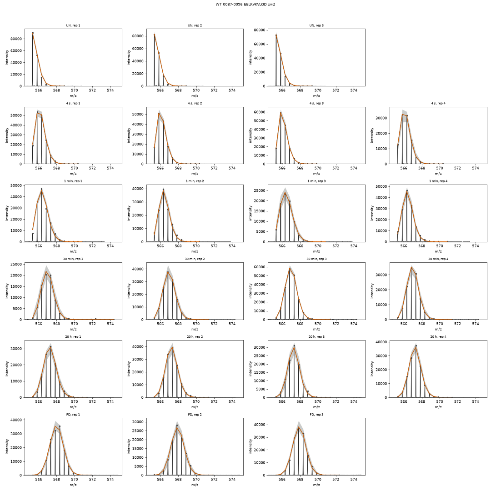
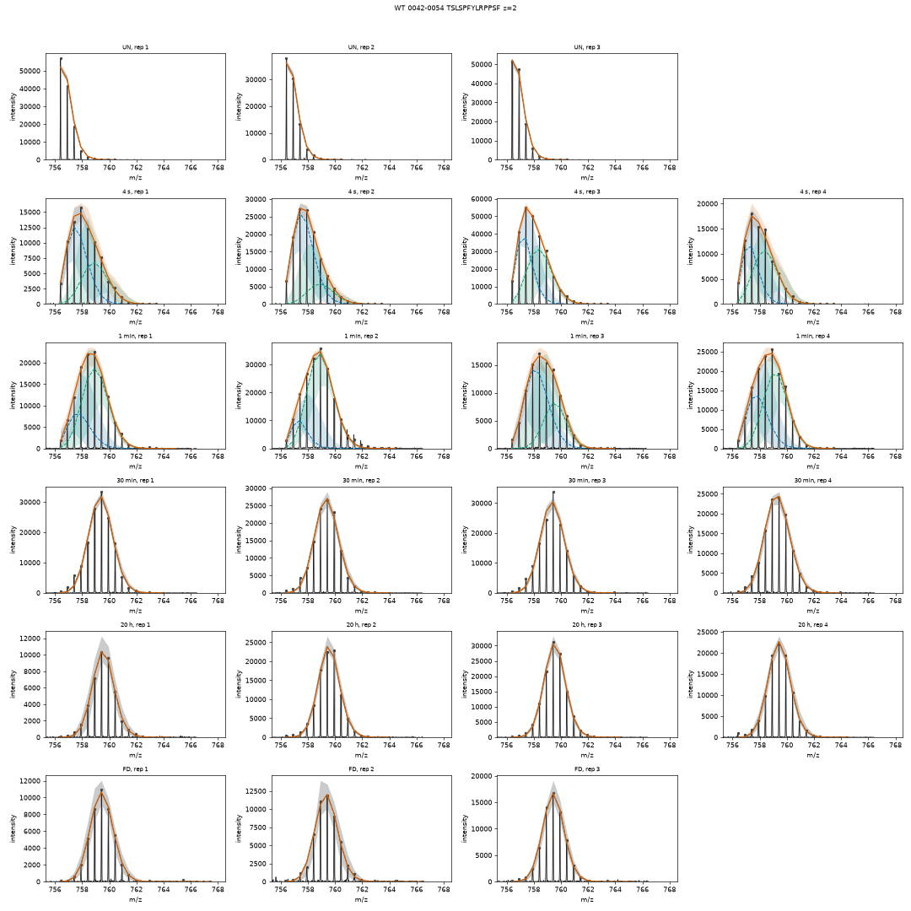
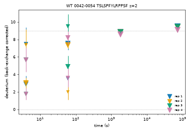
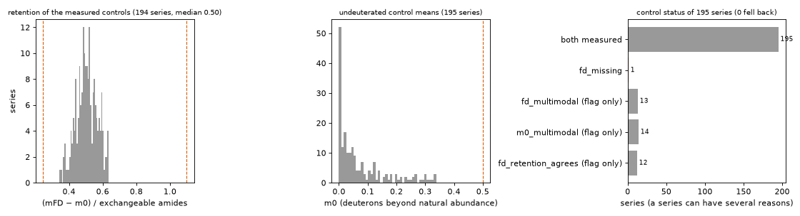
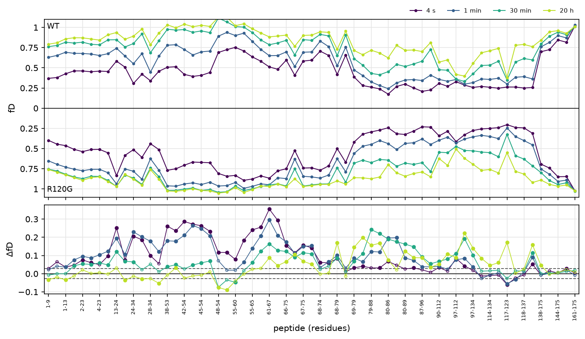
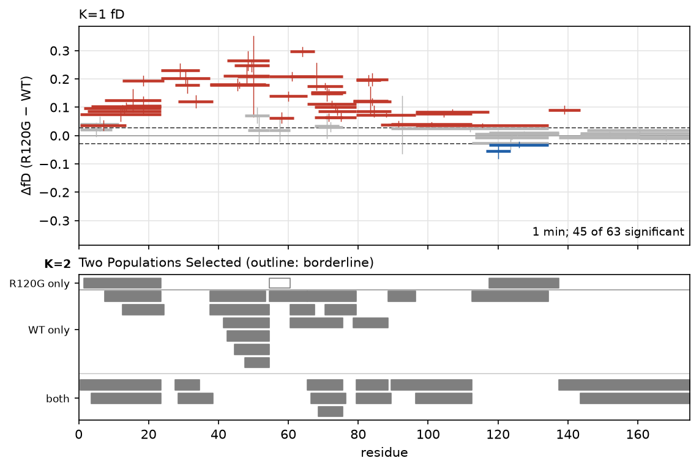
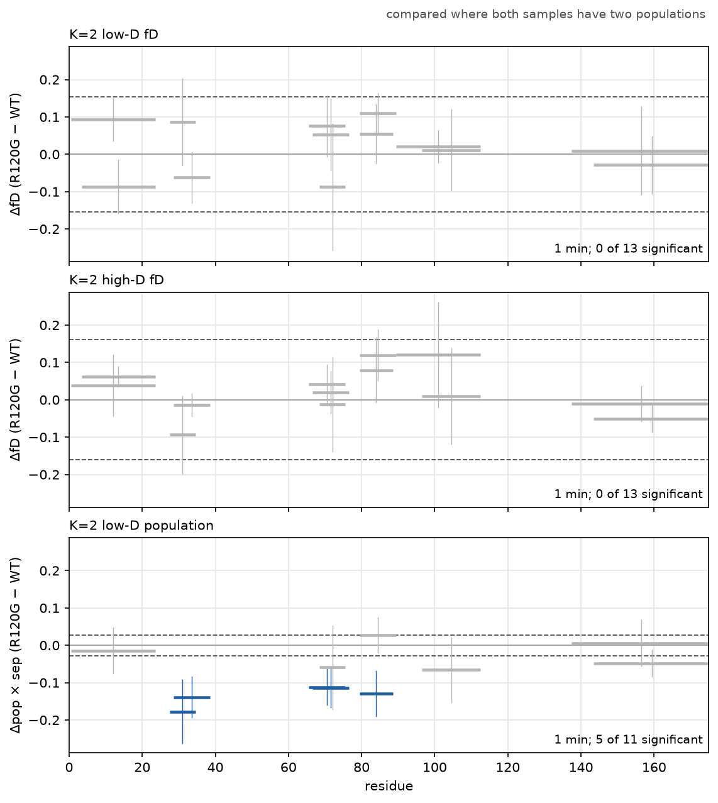
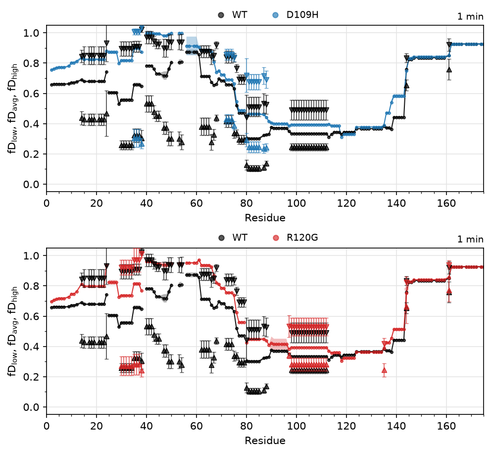

# Tutorial: a protein and two disease variants

This tutorial takes you through a complete *hxex* analysis of real, published data, from the
exported spectra to a comparison of three samples. You type every command yourself, so by the
end you will have used each part of *hxex* once and seen what it writes. It takes about an
hour, of which about half is the computer working.

The same steps are in a Jupyter notebook, which comes with the data (see
[The notebook](#the-notebook) at the end). This page needs no Jupyter.

## The data

The spectra are from a study of HSPB5 (αB-crystallin), a small heat shock protein, and two
variants of it linked to disease, D109H and R120G:

> Woods CN, Janowska MK, Ulmer LD, Kaur Sidhu J, Stone NL, James EI, Guttman M, Bush MF,
> Klevit RE. Activation mechanism of small heat shock protein HSPB5 revealed by
> disease-associated mutants. *Proc Natl Acad Sci USA* 122(20), e2425061122 (2025).
> <https://doi.org/10.1073/pnas.2425061122>

Please cite this paper if you use the data. Each protein (0.04 mg/mL) was labelled at room
temperature in 85 % D₂O buffer, pH 7.5, for 4 s, 1 min, 30 min, and 20 h, with three or four
replicates of each, and measured on a Waters Synapt G2-Si. Undeuterated and fully deuterated
controls were measured as well. The spectra were exported from HDExaminer as a SpecExport
folder, which is what *hxex* reads. The folders also hold two very short labelling times,
0.1 s and 0.8 s, measured with a quench-flow setup and not part of the paper: step 4 leaves
them out.

In total there are 5,261 spectra: 63 peptides in each of the three samples, at one or more
charge states.

## Before you start

*hxex* must be installed: see [Installing *hxex*](install.md). To check, open a terminal and
type `hxex --version`.

## Step 1: download the data

Download **`hxex_b5_tutorial.zip`** (39 MB) from
<https://github.com/tuttlelm/hxex/releases/download/tutorial-data-1/hxex_b5_tutorial.zip>
and unzip it where you keep your work, for example in `Documents`:

- **Windows:** right-click the file, choose **Extract All**, then **Extract**.
- **macOS:** double-click the file.
- **Linux:** right-click the file and choose **Extract Here**.

You now have a folder `hxex_b5_tutorial` with:

```
hxex_b5_tutorial/
├── SpecExport/                the spectra, as HDExaminer exported them
│   ├── WT/                    one folder per sample,
│   │   ├── 0001-0009-MDIAIHHPW/      one folder per peptide,
│   │   │   ├── Non-1-z2.csv          one file per time point, replicate, and charge
│   │   │   ├── 4s-1-z2.csv
│   │   │   └── ...
│   │   └── ...
│   ├── D109H/
│   ├── R120G/
│   ├── WT.fasta               the protein sequence of each sample
│   ├── D109H.fasta
│   └── R120G.fasta
├── hxex_b5_tutorial.ipynb     the notebook
├── README.txt
└── LICENSE.txt
```

The file names say what each spectrum is: `4s-1-z2.csv` is the 4 s time point, replicate 1,
charge 2. `Non` files are the undeuterated controls and `Full` files the fully deuterated
ones. You do not need to open any of them.

## Step 2: open a terminal in the folder

Open a terminal in `hxex_b5_tutorial`, as in
[Your first project, step 2](first-project.md#step-2-open-a-terminal-in-that-folder). Every
command below is typed there.

## Step 3: write the project file

```bash
hxex init --format specexport
```

This writes `hxex.toml`, the project file: a plain text file with every setting at its usual
value, each with a comment saying what it does. Open it in a plain text editor (Notepad,
TextEdit, or another; see
[Your first project, step 4](first-project.md#step-4-edit-the-project-file)). It is long,
but you only change a few lines. Lines starting with `#` are comments, or settings that are
switched off.

The data folder is already right: the template says `data_dir = "SpecExport"`, which is the
folder next to `hxex.toml`.

## Step 4: tell *hxex* about the experiment

Make three changes, and save the file.

**A name.** At the top, change `project = "my_project"` to:

```toml
project = "hspb5"
```

**Leave out the quench-flow time points.** In the `[input]` part there is a switched-off
example of an `[[input.exclude]]` rule. Below it (still above `[output]`), add two rules,
one for each time:

```toml
[[input.exclude]]
time = "0.1 s"
note = "quench-flow time point (not in the paper)"

[[input.exclude]]
time = "0.8 s"
note = "quench-flow time point (not in the paper)"
```

A spectrum that matches a rule is not fitted, but it is kept with the results, so nothing is
lost. [Excluding spectra](excluding-spectra.md) explains the rules.

**Turn on the back-exchange correction.** Near the end of the file, find the part that starts
with `# [run.controls]`. Delete the `# ` in front of `[run.controls]`, and in front of the
`d2o_fraction` line, and change its value to the labelling buffer's 85 % D₂O:

```toml
[run.controls]
...
d2o_fraction = 0.85
```

(The other lines of that part can stay switched off.) The correction uses the undeuterated
and fully deuterated controls to put every peptide on the scale of its own exchangeable
amides; [Back-exchange correction](back-exchange-correction.md) explains how.

## Step 5: check

```bash
hxex check hxex.toml
```

*hxex* reads the settings and looks through the folders without analysing anything:

```
project        hspb5
format         specexport
K              1 to 3
...
controls       on
...
excluded       2 rule(s), left out before fitting (stored, not fitted): time 100 ms (quench-flow time point (not in the paper)); time 800 ms (quench-flow time point (not in the paper))
entries        195 in SpecExport
  D109H: 65 entries, 195 undeuterated and 125 fully deuterated control files
  R120G: 65 entries, 129 undeuterated and 106 fully deuterated control files
  WT: 65 entries, 194 undeuterated and 193 fully deuterated control files
ok
```

An *entry* is one peptide at one charge in one sample (65 per sample here). `K 1 to 3` means
each spectrum will be fitted with one, two, and three populations, and the best is chosen. If
`check` reports a problem instead of `ok`, it says which line of the file to fix.

## Step 6: run

```bash
hxex run hxex.toml
```

This is the analysis itself. *hxex* reads the spectra, leaves out the 1,384 quench-flow
spectra, picks the isotope peaks of the remaining 3,877, and fits every one of them. It
prints its progress, and takes about two minutes on a laptop:

```
15:53:24 [[input.exclude]]: 1384 of 5261 spectra left out (stored, not fitted)
15:53:27 dropped 3 of 3877 spectra: 3 empty, 0 without signal
15:53:27 fitting K=1 for 3874 measurements
15:53:46 fitting K=2 for 3874 measurements
15:54:09 fitting K=3 for 3874 measurements
15:54:38 done in 1m 14s
3874 measurements; selected K: 1: 2912, 2: 839, 3: 123
```

Three spectra were empty and are dropped. Most spectra are best described by one population
(K = 1), but 839 need two and 123 three.

The run wrote two folders: `results`, the *bundle*, which holds everything in *hxex*'s own
format (you do not open it yourself; the other commands read it), and `results_tables`, the
tables, which you do open.

## Step 7: the tables

Open `results_tables` and double-click a file to open it in your spreadsheet program:

- **`series.csv`**: one row per peptide and charge in each sample (195 rows). The columns
  `controls` and `retention` show how each was corrected: `measured` means its own controls
  were used. `n_multi` counts its spectra with more than one population.
- **`spectra.csv`**: one row per spectrum, with its time, replicate, chosen number of
  populations (`K`), and each population's deuterium (`mean_1`, `mean_corrected_1`, ...) and
  share (`population_1`, ...).
- **`uptake.csv`**: the deuterium uptake of every peptide at every time, replicates averaged.
- **`components.csv`**: every fit, at every number of populations, for other programs.

[Outputs](outputs.md) describes every column.

## Step 8: the figures

The run draws no figures, because a run with many peptides would draw thousands. You choose
what to draw, in the `[figures]` part of `hxex.toml`. Three peptides of WT, all at charge 2,
show what to look for:

- residues 87-96 (EELKVKVLGD), with one population throughout;
- residues 42-54 (TSLSPFYLRPPSF), with two populations at the early times;
- residues 68-75 (MRLEKDRF), which has a weak spectrum.

Find their numbers in the `data_id` column of `series.csv` (sample `WT`, `peptide_range`
`0087-0096`, `0042-0054` and `0068-0075`, charge 2): 140, 56, and 107. In `hxex.toml`, find
the `[figures]` part and change the `series` and `scale` lines to:

```toml
[figures]
series = [140, 56, 107]
...
scale = "log"
```

`scale = "log"` spreads the times out on the uptake plots (4 s, 1 min, 30 min, and 20 h are
hard to tell apart on a straight scale). Then draw:

```bash
hxex report hxex.toml --figures
```

This writes `results_figures`, with one PDF per peptide (a page each of spectra, populations,
and uptake) and `overview.pdf`.

**One population.** In `WT_0087_0096_EELKVKVLGD_z_2.pdf` every spectrum is one smooth envelope.
The black sticks are the measured isotope peaks, the line through them is the fit, and the
envelope moves to the right (more deuterium) with time:



**Two populations.** In `WT_0042_0054_TSLSPFYLRPPSF_z_2.pdf` the 4 s and 1 min spectra are too
broad for one envelope: the fit uses two (the dashed lines), a slow one that has taken up
little deuterium and a fast one that has taken up much more. By 20 h they have merged into one.
The undeuterated (UN) and fully deuterated (FD) controls have one population each, as they
should. (The figure here was drawn after the review of step 9; in yours, two of the 30 min
spectra still have a small second population.)



The uptake page shows the deuterium of every population of every spectrum against time,
coloured by replicate: two levels at 4 s and 1 min, one from 30 min on (this figure was drawn
after the review of step 9):



**The overview.** `overview.pdf` summarises the whole run. Its controls page shows the
retention of every fully deuterated control: the share of the label it still held when
measured. Here it is about 0.5, much below the 0.85 of the buffer, because deuterium exchanges
back during the quench, digestion, and LC. All 194 measured controls were accepted (the
dashed lines are the limits they were judged by); the one peptide and charge without a fully
deuterated control takes the control of the same peptide at its other charge. The bars below
`both measured` count controls that are used but carry a note: here, controls whose replicates
were best fitted with two populations, which happens for a few peptides with broad envelopes,
and, for most of those, that their retention agrees with the same peptide's in the other
samples, so the correction is sound.



## Step 9: review

Two things in these figures deserve a decision:

- In WT 42-54, the 30 min replicates 1 and 3 were fitted with two populations, but one of
  them is tiny. One population describes them as well as it does replicates 2 and 4.
- In WT 68-75, the 30 min replicate 2 is far weaker than the others; `spectra.csv` gives it
  the `low_intensity` flag. It is better left out.

Decisions like these go in a *review table*: your own copy of `spectra.csv` in which you fill
in three columns. Copy `results_tables/spectra.csv` into the project folder, next to
`hxex.toml`, and rename the copy `user_review_table.csv`. Open it, and:

1. In the rows of `WT`, `0042-0054`, time `1800` (30 min), replicates (`rep`) 1 and 3, type
   `1` in the `review_K` column, and in the `note` column `second population too small`.
2. In the row of `WT`, `0068-0075`, time `1800`, replicate 2, type `rejected` in the
   `review_status` column, and `weak spectrum` in `note`.

Save it, keeping the CSV format. Then tell *hxex* about it: in `hxex.toml`, find the
switched-off `# [review]` part, and switch on its first two lines:

```toml
[review]
table = "user_review_table.csv"
```

Check that *hxex* reads your three decisions, and draw the figures again:

```bash
hxex check hxex.toml
hxex report hxex.toml --figures --overwrite
```

`--overwrite` replaces the figures drawn before; without it, *hxex* stops rather than write
over them. `check` now has the line `review table ... 3 spectra: 1 rejected, 0 accepted, 2 with a chosen
K`. In the new figures the rejected spectrum is drawn hollow and grey, and the two 30 min
spectra of WT 42-54 have one population. The tables changed too. The fits themselves are not
touched: delete a row's entries, or the `[review]` lines, and report again to undo.
[The user review table](project-file.md#the-user-review-table) has the details.

## Step 10: add the uncertainties

So far the results have no error bars. They come from the *bootstrap*: every spectrum is
refitted many times with resampled noise, and the spread of the refits gives each value its
standard error. It is the slow part, so it is a separate step. In `hxex.toml`, find the
switched-off `# [run.bootstrap]` part, delete the `# ` in front of `[run.bootstrap]`, in front
of `n_boot = 20`, and in front of the `ks` line, and change that line to:

```toml
[run.bootstrap]
n_boot = 20
...
ks = [1, 2]
```

`ks = [1, 2]` bootstraps every spectrum with one and with two populations, which the
comparison of step 11 needs. Then add the bootstrap to the results you have:

```bash
hxex resume hxex.toml
```

This takes 20 to 30 minutes on a laptop (13 minutes on a fast desktop); it prints its progress
and the time left. A computer with an NVIDIA graphics card and the GPU version of *hxex* does
it in about four minutes ([Installing *hxex*](install.md)). When it is done, draw the figures
again; they now have error bars:

```bash
hxex report hxex.toml --figures --overwrite
```

## Step 11: compare the variants with WT

The last step compares the samples. In `hxex.toml`, find the switched-off `# [analysis]` part.
Switch on its first line, the `reference` line below it, and its `format` line, changed to
`"png"`:

```toml
[analysis]
reference = "WT"
format = "png"
```

`reference = "WT"` compares D109H and R120G with WT. `format = "png"` writes the figures as
pictures that open with a double-click (the default, `pdf`, is better for publication). Then:

```bash
hxex analyse hxex.toml
```

This takes under a minute and writes `results_analysis_WT`, with tables and about 40 figures.
A few of them:

**The butterfly plot** (`butterfly_R120G.png`) shows the deuterium of every peptide, WT above
and R120G below, one line per time, and their difference underneath. R120G takes up more
deuterium than WT over the first 80 residues, most at the early times:



**The Woods plot** comes as two figures. The first (`woods_R120G_1min.png`) shows the same
difference at one time, one bar per peptide over the residues it covers, coloured where the
difference is significant (red higher, blue lower than WT). Below it, *Two Populations
Selected* shows the peptides whose spectra are best described by two populations in R120G only,
in WT only, or in both. Many peptides of the first 90 residues have two populations in WT but
only one in R120G:



The second figure (`woods_K2_R120G_1min.png`) compares the two populations, only for the
peptides that have two in both samples: the positions of the two populations, and the change in
the share of the low-D population, multiplied by the distance between the two populations, so
that it is in the same units as the panels above and judged against the same kind of dashed line
([Reading the Woods plot](outputs.md#figures-from-hxex-analyse)). Here the positions hardly
differ, but R120G has less of the low-D population: the same two states, populated differently.



Peptides that contain the mutation are compared too, with WT's peptide over the same residues
(they are marked `same_sequence = false` in `compare_peptides.csv`); to compare only identical
sequences, set `peptide_match = "sequence"` in `[analysis]`.

**The residue comparison** (`compare_residues_1min.png`) goes residue by residue: the average
deuteration as small circles on a line with its error band, and, where a sample has two
populations, the low-D and high-D populations as up and down triangles
([Reading the residue comparison](outputs.md#figures-from-hxex-analyse)):



The tables hold the same values: `compare_peptides.csv` per peptide, `compare_residues.csv` per
residue, with the differences, their errors, and whether they are significant.
`species_uptake.csv` gives, for every peptide and time, the number of populations best
supported by all of its spectra together (`best_set_K`). [Outputs](outputs.md) and
[Analysis methods](../ANALYSIS.md) describe them.

## What you did

| Step | Command | What it did |
|---|---|---|
| 3 | `hxex init --format specexport` | wrote the project file |
| 5 | `hxex check hxex.toml` | checked the settings and the data |
| 6 | `hxex run hxex.toml` | fitted every spectrum; wrote the bundle and the tables |
| 8, 9 | `hxex report hxex.toml --figures` (`--overwrite` the second time) | drew the figures, with your review |
| 10 | `hxex resume hxex.toml` | added the bootstrap (the error bars) |
| 11 | `hxex analyse hxex.toml` | compared the variants with WT |

Changing a setting only means running again the command it belongs to, with `--overwrite`:
[`run`, `report`, and `analyse`: what each one does](project-file.md#run-report-and-analyse-what-each-one-does).
To work through the tutorial again from the start, first delete every folder whose name starts
with `results`, or the commands stop at the results already there
([Running again](outputs.md#running-again)).
For your own data, start from [Your first project](first-project.md).

## The notebook

`hxex_b5_tutorial.ipynb`, in the downloaded folder, has the same steps as cells you run one
by one, and draws the figures inside the notebook, so you can look at any peptide by typing
its name. To use it, install *hxex* with Jupyter Notebook as well (this replaces your
installation; use the same `--index` options as in [Installing *hxex*](install.md) if you used
any there):

```bash
uv tool install "hxex[notebook] @ https://github.com/tuttlelm/hxex/archive/refs/heads/main.zip" --with-executables-from notebook,jupyter-core --reinstall
```

Then, in the terminal in `hxex_b5_tutorial`, type `jupyter notebook`. A browser window opens;
click `hxex_b5_tutorial.ipynb`, and run each cell with Shift + Enter.
